# ES Arena

[](https://ko-fi.com/N0C328KVIG)
[](https://www.patreon.com/cw/Arenasloppa)

**The Elder Scrolls: Arena (1994), remade in Three.js.**

ES Arena is an unofficial remake of Bethesda's first Elder Scrolls game. It runs as a desktop app on Mac and Windows,
or in a web browser. It is written in TypeScript with Three.js by AI: Claude, made by Anthropic, and ChatGPT, made
by OpenAI.
You play it with your own copy of Arena: the game reads the original maps, textures, creatures, sounds and text from your
`ARENA` folder while it runs, so none of Bethesda's files are in this repository.

## Screenshots

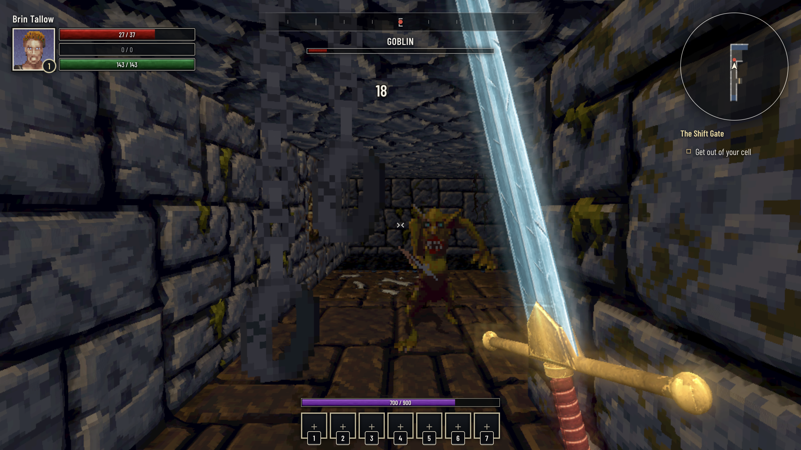

| | |
|---|---|
| <br>Choosing a race on the map of Tamriel | 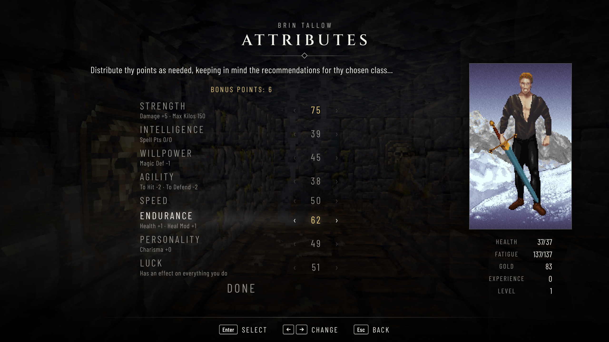<br>Sharing out bonus points |
| 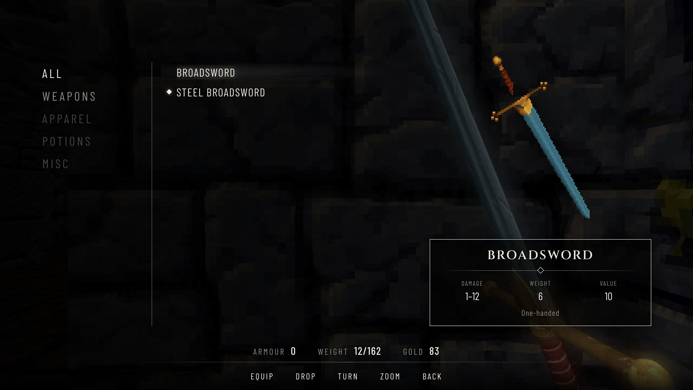<br>The item menu | 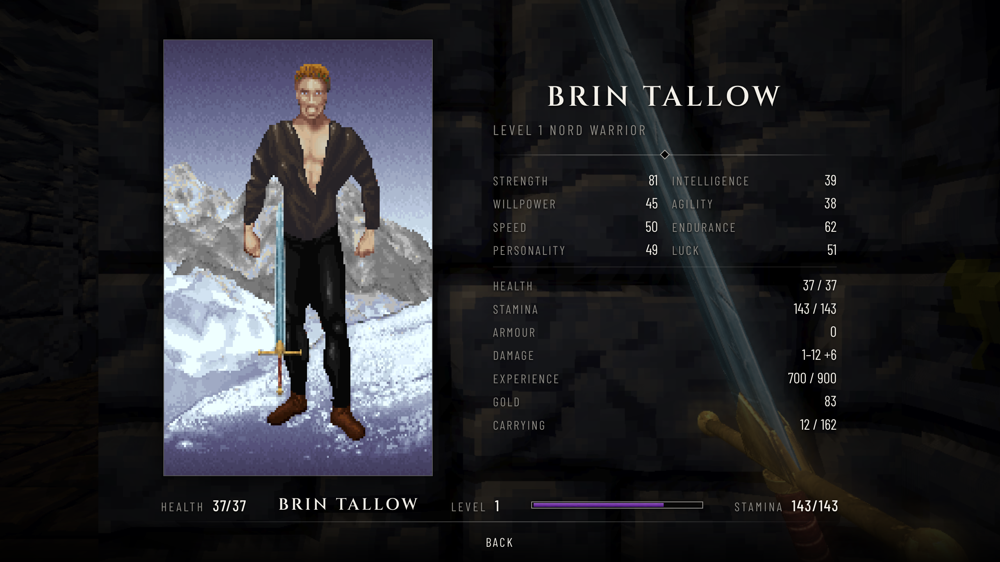<br>The character sheet |
| 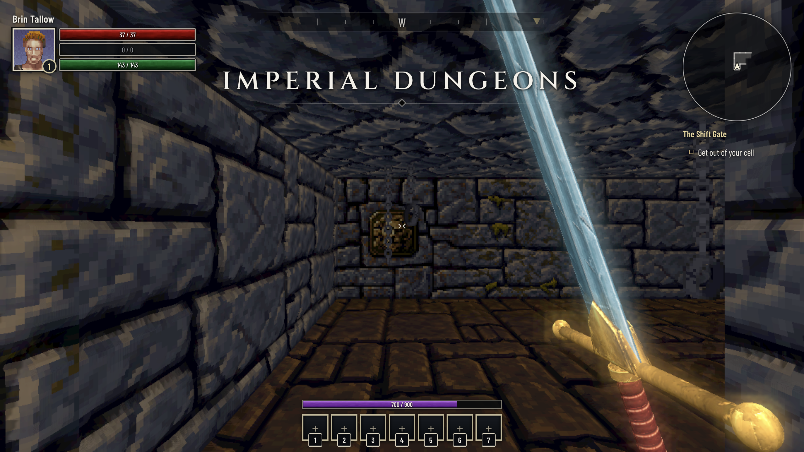<br>Arriving in the cell where Arena begins | 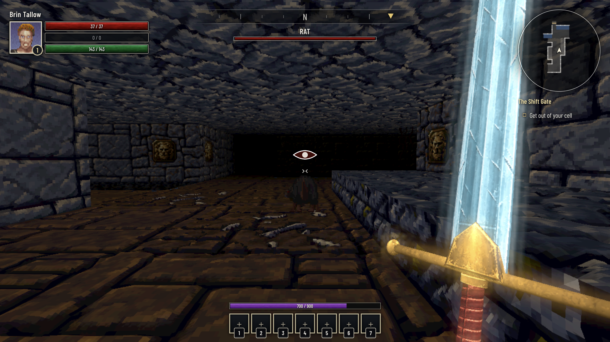<br>Sneaking up on a rat |
| 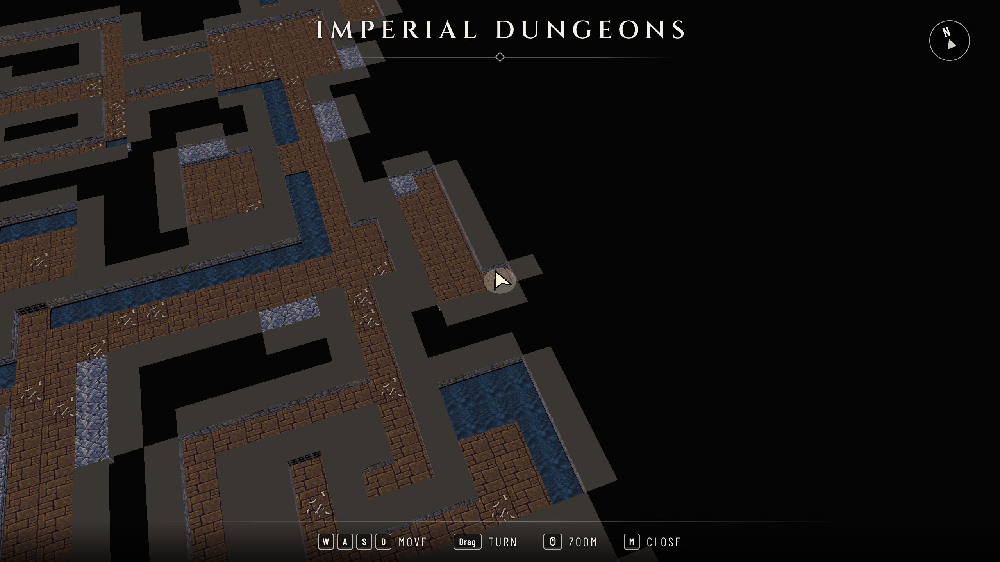<br>The map fills in as you explore | 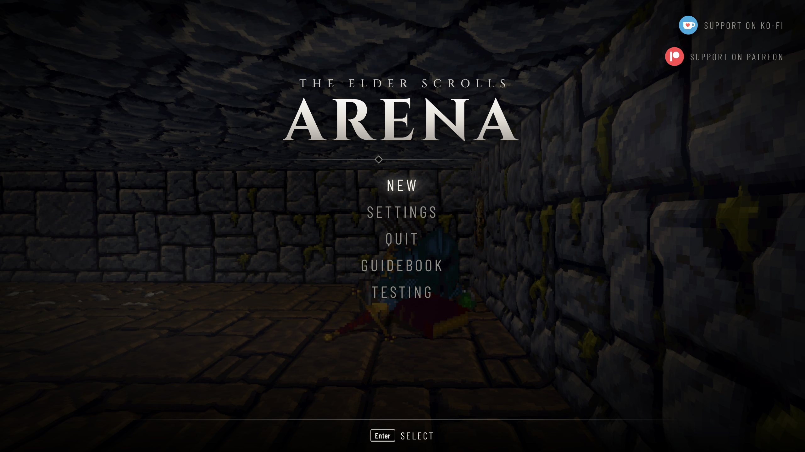<br>The main menu |
| 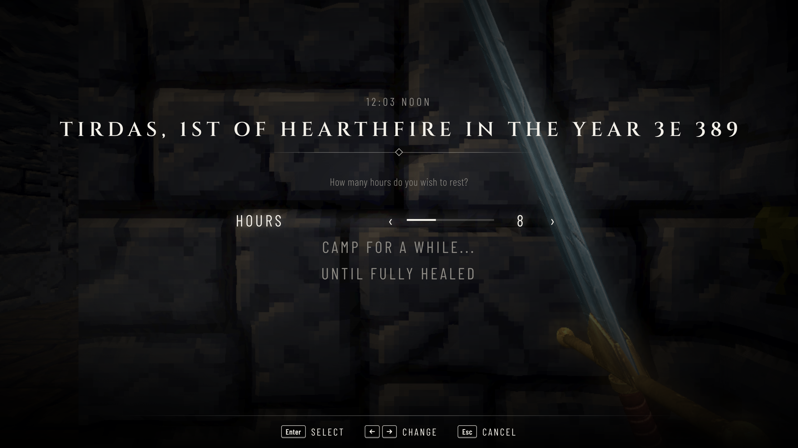<br>Waiting, with the date and time in Arena | 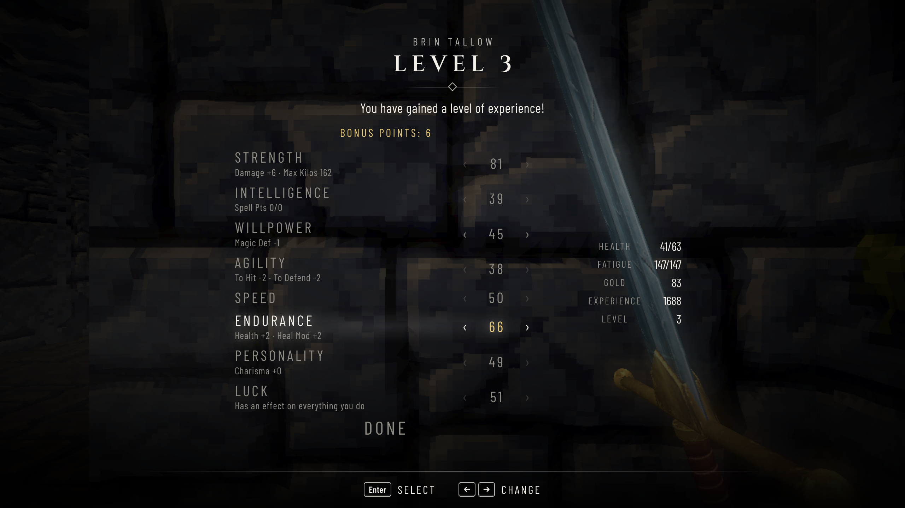<br>A level gained, with bonus points to share out |
| 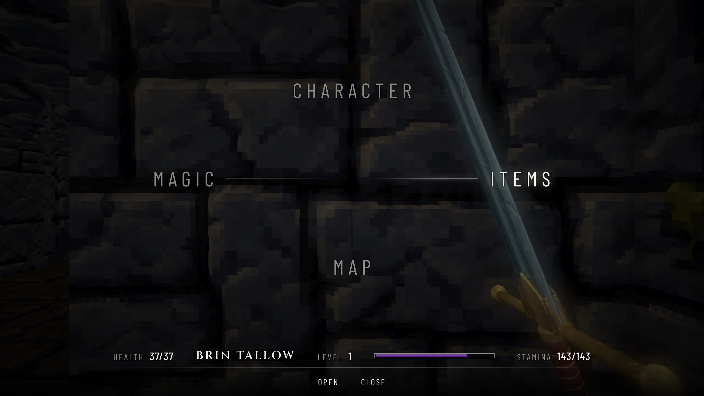<br>The menu of menus, aiming at the items | |
| 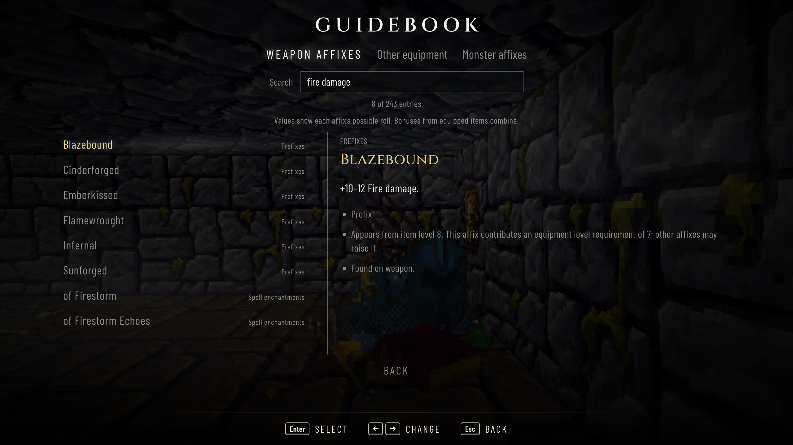<br>Weapon affixes in the Guidebook | 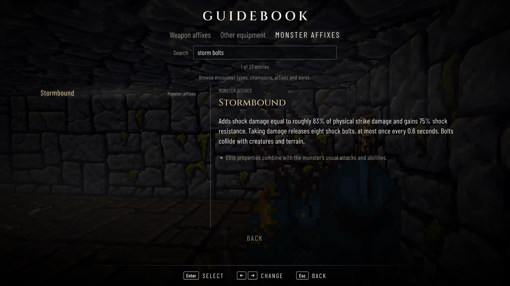<br>Monster affixes and abilities |
| 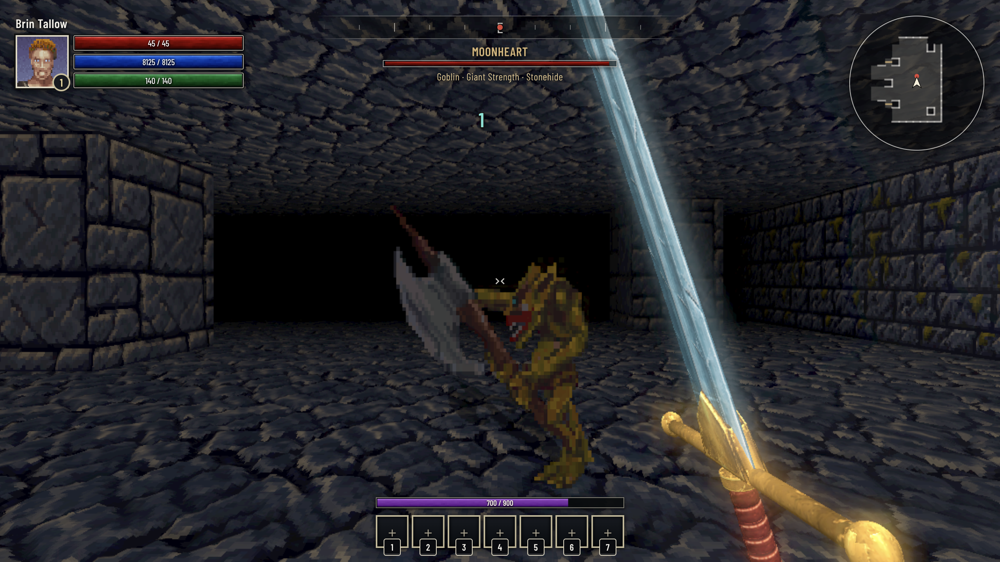<br>Named elite encounters | 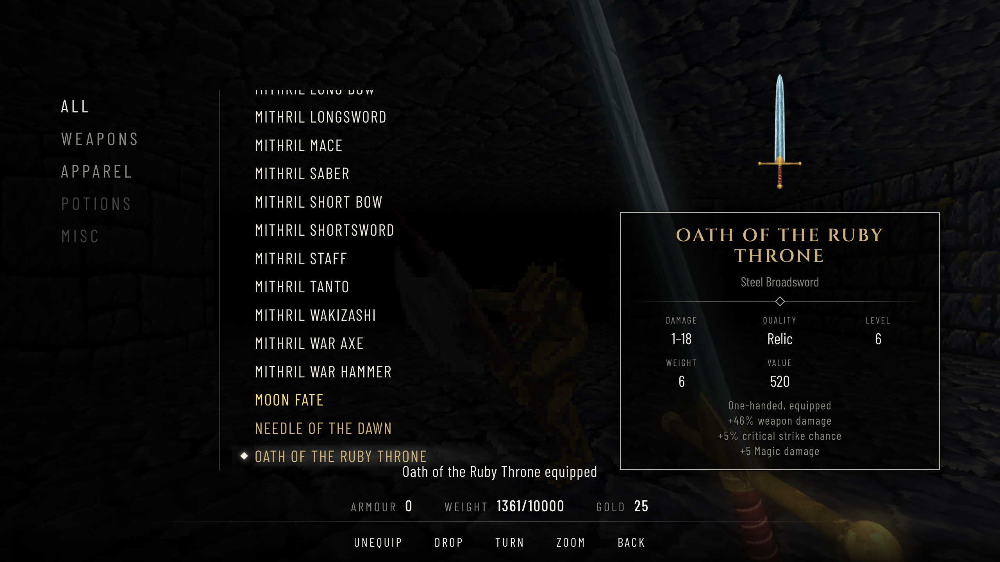<br>Randomized loot and relics |

The screenshots are taken from the game as it stands with `npm run screenshots` and retaken for every release.
They show Arena's own art, which the remake reads from a copy of the game. The [gallery](docs/gallery.md) keeps the
screenshots of earlier versions.

## What works so far

- A searchable Guidebook in the main and pause menus explains weapon and equipment affixes, spell enchantments,
  elite monster properties, champion types and auras. It supports keyboard, mouse and controller browsing.
- Randomized equipment with 211 prefixes and 145 suffixes, quality colours, named relics and equipment sets.
  Level and item restrictions govern each roll, and equipped bonuses affect combat, resources, resistances and loot.
  Item rolls, identification, equipment, spell charges and character progression are saved between sessions.
- Named elite monsters and champion groups have stronger stats, special abilities and better loot. Weapon Testing
  cycles through ordinary monsters, champions and elite affixes, one opponent at a time.
- Floating damage numbers show actual damage over enemies, with distinct colours for critical hits and damage types.
- Original / Remake graphics: Original uses the original dungeon textures and no added lighting effects; Remake is
  the default, with new pixel-art textures and 3D dungeon surfaces, bump maps, specular lighting, glow, ambient
  occlusion, volumetric light and dynamic shadows for creatures and objects.
- Choose your `ARENA` folder and the game checks that it has everything it needs.
- Textured 3D Steel weapons and the Silver Dagger, with weapon-specific swings, power attacks, blocks and shoves,
  bow drawing, arrow surface impacts and recovery, and constrained flail motion. Other material variants keep their existing artwork.
  Finished 3D weapons also have rotatable inventory previews.
- A HUD with a character portrait, health/magicka/stamina bars, buff/debuff icons and timers, a seven-slot hotbar,
  experience progress and quest objectives beneath the minimap.
- The main menu's Test Area offers Weapon Testing and Effect Testing. It supplies weapons and spells, keeps the
  player immortal, cycles through monsters, and allows buffs and debuffs to be added together for testing.
- Make your character in Skyrim's order, in Arena's own words: choose your gender, race and face together, with your
  race's province marked on Arena's map of Tamriel; pick a name (or a random one in your race's style, Arena's own or by
  the race's customs in the lore); answer ten questions or choose from the eighteen classes; and share out bonus points
  among attributes rolled by Arena's rules on a sheet that shows what the original's does. Arena's paper doll shows you
  as you are so far beside every step, and tries on each class's clothes and gear as you look through them. Your race,
  class and attributes count in play: they set your health, fatigue, damage, pace and how much you can carry, which
  armour and weapons you can use, and whether you can pick locks; and each race and class has its gifts from Arena,
  such as the Redguard's way with weapons, the Khajiit's climbing, the Argonian's swimming, the High Elf's immunity to
  paralysis, the Acrobat's leaps and the Ranger's extra damage.
- Escape the Imperial Dungeons where Arena begins: get out of your locked cell, get past the rats and goblins, and
  find the Shift Gate.
- Monsters with Arena's own pictures and stats. They wander, notice you when they see you, chase you round corners
  and fight, landing their blows by Arena's rule: the armour where they strike, your Agility against theirs and the
  levels on both sides decide whether a blow lands. Lizard Men and Spiders can paralyse you, as in Arena.
- Combat in Skyrim's style with Arena's weapons and swings: power attacks, blocking, bashing, and sneak attacks for
  three times the damage. Bows shoot Arena's arrows, as quickly as your Speed lets you nock the next, and do double
  damage from hiding. While you sneak, an eye shows how close the creatures nearby are to noticing you.
- Arena's own spells, read from your copy: Fire Dart, Fireball, Shock, Heal, Light, Shield, Invisibility, Open,
  Medusa's Gaze and all 64 spells in the Mages Guild's spell list. Spellcasting
  classes have spell points as in Arena, by their class and Intelligence, and spells cost less at each level. Assign a
  spell from the magic menu to the hotbar, then cast it with its assigned key or controller button; bolts fly, area
  spells burst, and paralysis, poison, shields and light last as many rounds as the game says.
- Camp as in Arena, from a wait menu like Skyrim's: rest some hours or until healed, by Arena's healing sums and in its
  words, though not with monsters near, and monsters may come upon you while you sleep. The first rest after reaching
  level 2 brings Ria Silmane's dream of the Staff of Chaos and of Fang Lair, in her own voice.
- Level up as in Arena: its experience for each level, your class's hit die for health, and 3 to 6 bonus points a
  level to share out among your attributes on the character sheet. Endurance's health bonus counts for every level you
  have, so raising it late is worth as much as raising it early.
- Treasure piles, gear spots and bodies use Arena's base drop and material tables with randomized equipment
  properties and quality rolls. Open the loot list to take individual drops or Take All; closing it leaves the
  remaining loot available. Open locked doors with their key, pick their locks or break them down.
- Skyrim's menus: a menu of menus for your character, items, magic and the map, where you aim at one and let go to
  open it; an item menu where you equip, drink, cast from and drop things; and a character sheet with Arena's paper doll
  wearing what you wear. Spells and usable items can be assigned to the seven-slot hotbar for keyboard or controller use.
- A 3D map that fills in as you explore, a minimap, quest objectives, and markers on the compass for the next
  objective and the creatures nearby.
- Arena's own sound effects, each coming from where it happens in the dungeon.
- Arena's own music, played as on a 1994 AdLib or Sound Blaster: the remake emulates the FM chip and plays the game's
  songs with the game's own instruments. The main menu, character creation, the visions and each dungeon have their
  songs, as in Arena.
- Arena's cutscenes: the opening with the book, the title and the scroll; the story of the Emperor's betrayal before
  you make a character; and Ria Silmane's visions, spoken by the CD version's voices with the words beneath, when you
  wake in your cell and when you die.
- Original or remade wall, floor and ceiling surfaces, animated water and lava, raised platforms, doors that slide open,
  barred doors you can see through, decorations such as chains and barrels, and the dungeon's own messages when you
  reach their squares.
- Play with a controller or the keyboard and mouse, with Skyrim's controls, menu and HUD: a compass, button prompts
  that match your controller, jumping, sneaking and sprinting, and the dungeon's name as you arrive.

Coming later: cities and the wilderness, the Mages Guild and the spellmaker, and full world saves.

## Play it

You need your own copy of Arena; it's free on Steam and GOG.

### Download the app

Get the zip for your computer from the [Releases page](https://github.com/arenasloppa/ES-Arena/releases/latest).
The "Source code" downloads there are for programmers and won't open by double-clicking.
The app needs macOS 13 (Ventura) or newer, or Windows 10 or newer.

| Your computer | Download |
|---|---|
| Mac with an Apple chip (M1 or newer) | `ES-Arena-<version>-Mac-Apple-silicon.zip` |
| Mac with an Intel chip | `ES-Arena-<version>-Mac-Intel.zip` |
| Windows PC | `ES-Arena-<version>-Windows.zip` |

- **Mac:** double-click the zip, then double-click ES Arena. The first time, macOS says it could not verify the app,
  because it isn't signed with a paid Apple developer certificate. Click Done, open System Settings, go to
  Privacy & Security, scroll down to the message about ES Arena and click Open Anyway.
- **Windows:** right-click the zip, choose Extract All, open the new folder and double-click ES Arena.
  If Windows says it protected your PC, click More info, then Run anyway.

When the game opens, click **Choose ARENA folder…** and pick the `ARENA` folder, the one that holds `GLOBAL.BSA`.
In the Steam release it sits inside the game's install folder; the GamesNostalgia downloads call it `arena` (Windows)
or `game/Resources/arena` (Mac). Picking a folder above it also works, since the game looks a few folders down,
and file name case doesn't matter. The app remembers the folder for next time. Your files never leave your computer.

### Run it from the source code

Use [Node.js](https://nodejs.org) 22.12 or later in the 22.x series, or Node.js 24.x, for the source build and tests.

```sh
npm install
npm run dev     # then open the address it prints in your browser
npm run app     # or open it as the desktop app
```

### Controls

Xbox button names are shown below, with PlayStation equivalents in brackets. On-screen prompts follow the controller being used.

| Action | Keyboard and mouse | Controller |
|---|---|---|
| Move | <kbd>W</kbd> <kbd>A</kbd> <kbd>S</kbd> <kbd>D</kbd> | Left stick |
| Look | Mouse (click the view to capture it) | Right stick |
| Walk and turn | Up/down arrows walk; left/right arrows turn | |
| Attack or shoot; hold to charge a power attack or draw the bow | Left mouse button | RT (R2) |
| Block; attack while blocking to shove | Right mouse button | LT (L2) |
| Interact: use, take or open | <kbd>E</kbd> | A (✕) |
| Jump | <kbd>Space</kbd> | Y (△) |
| Sprint | Hold <kbd>Shift</kbd> | Click the left stick (L3) to toggle while moving |
| Toggle sneak | <kbd>C</kbd> | Click the right stick (R3) |
| Use hotbar slot 1 | <kbd>1</kbd> | D-pad left |
| Use hotbar slot 2 | <kbd>2</kbd> | D-pad up |
| Use hotbar slot 3 | <kbd>3</kbd> | D-pad right |
| Use hotbar slot 4 | <kbd>4</kbd> | X (□) |
| Use hotbar slot 5 | <kbd>5</kbd> | B (○) |
| Use hotbar slot 6 | <kbd>6</kbd> | LB (L1) |
| Use hotbar slot 7 | <kbd>7</kbd> | RB (R1) |
| Character, items, magic and map | <kbd>Tab</kbd> | View (Share/Create) |
| Open items or magic directly | <kbd>I</kbd> or <kbd>P</kbd> | Choose from the menu of menus |
| Open map | <kbd>M</kbd> | Down from the menu of menus |
| Wait: camp for some hours or until healed; press again to wake | <kbd>T</kbd> | D-pad down |
| Pause | <kbd>Esc</kbd> | Start (Options) |

In the menu of menus, use the arrow keys, <kbd>W</kbd> <kbd>A</kbd> <kbd>S</kbd> <kbd>D</kbd>, the left stick or D-pad to highlight a section, then release the direction to open it. <kbd>Enter</kbd> or A also opens the highlighted section. The mouse highlights a section by pointing at it.

In the item menu, <kbd>F</kbd> or X identifies the selected unidentified item. <kbd>E</kbd>, <kbd>Enter</kbd> or A uses or equips the selected item. In the magic menu, these buttons open hotbar assignment for the selected spell. LB/RB change item categories. <kbd>C</kbd> or RT casts an enchanted item's spell, and <kbd>R</kbd> drops the selected item. Drag the item preview or use the right stick to rotate it; the mouse wheel or clicking the right stick changes its zoom. <kbd>Page Up</kbd>/<kbd>Page Down</kbd> or LT + right stick scroll long item descriptions. <kbd>Esc</kbd> or B goes back; <kbd>Tab</kbd> returns directly to the game.

The hotbar accepts spells and usable items, not weapons. Select an entry in Items or Magic and press <kbd>H</kbd> or Y to open the assignment picker. Press <kbd>1</kbd>–<kbd>7</kbd> or the controller button for the desired slot to assign it. You can also highlight a slot and confirm with <kbd>Enter</kbd> or A. <kbd>Esc</kbd> or Y cancels assignment. Pressing a number directly while an assignable entry is selected also assigns that slot.

When looting, choose entries with up/down, the left stick or D-pad. <kbd>E</kbd>, <kbd>Enter</kbd> or A takes the selected entry; <kbd>R</kbd> or Y takes all; <kbd>Esc</kbd>, <kbd>Tab</kbd> or B closes the list.

On the map, move with <kbd>W</kbd> <kbd>A</kbd> <kbd>S</kbd> <kbd>D</kbd> or the left stick, drag with the mouse or use the right stick to turn it, and zoom with the mouse wheel or LT/RT. Keyboard map rotation uses <kbd>Q</kbd>/<kbd>E</kbd> and <kbd>R</kbd>/<kbd>F</kbd>; <kbd>-</kbd>/<kbd>+</kbd> zoom. <kbd>M</kbd>, <kbd>Esc</kbd>, <kbd>Tab</kbd> or B closes the map.

In the main menu and character creation, use the arrow keys, D-pad or left stick to move, <kbd>Enter</kbd> or A to choose, and <kbd>Esc</kbd> or B to go back. Settings control look speed, inverted look, sound/music volume, opening playback, vibration and the ARENA folder.

In the Guidebook, search by name or effect and select an entry to read its description. LB/RB switch sections, the D-pad or left stick browses entries, the right stick scrolls details, and B returns to the menu.

In a cutscene, <kbd>Enter</kbd>, <kbd>Space</kbd>, a click or A advances; <kbd>Esc</kbd>, B or Start skips the rest.

In Effect Testing, <kbd>F6</kbd> adds a buff, <kbd>F7</kbd> adds a debuff, <kbd>F8</kbd> clears effects, and <kbd>F9</kbd>/<kbd>F10</kbd> toggle automatic buff/debuff cycling.

### Files it reads

The game needs these files from your copy: `GLOBAL.BSA`, `ACD.EXE` (or the floppy version's `A.EXE`), `PAL.COL`,
`TEMPLATE.DAT`, `QUESTION.TXT`, `CITYDATA.65`, `SPELLSG.65`, and a font (`ARENAFNT.DAT` or `FONT_A.DAT`).
The monsters' and weapons' stats come from the game's program, `ACD.EXE` or `A.EXE`, which the remake unpacks in
memory; the pictures, animations and sounds come from `GLOBAL.BSA`. Character creation reads its questions, classes,
names and words from `QUESTION.TXT`, `CLASSES.DAT`, `NAMECHNK.DAT` and the game's program, the map of Tamriel from
`TAMRIEL.MNU`, and the faces, clothes and armour of the paper doll from `GLOBAL.BSA`; without them it offers three
classes of its own. The spells come from `SPELLSG.65`. The music is in `GLOBAL.BSA` and its instruments in `SAMPLE.AD`
(or `SAMPLE.OPL`); without them the game is silent. The cutscenes are the CD version's loose `.FLC` animations and the
pictures in `GLOBAL.BSA`, with the visions' words from `TEMPLATE.DAT` and their voices from the `SPEECH` folder; any
that are missing are left out. Loose files take priority over the copies inside `GLOBAL.BSA`, as in the original. Saves and other
files a played copy creates (`SAVEGAME.0x`, `WILD00x.0x`, `AUTOMAP.0x`, `*.$$$`, `SOUND.CFG`, `VISION.EMS`) are ignored.

## How it works

| Path | What it does |
|---|---|
| `src/formats/` | Readers for Arena's file formats: the BSA archive, COL palettes, IMG/SET/RCI images, CIF and CFA animations, VOC sounds, MIF maps, INF level definitions, the game's program (unpacking it and reading the creature, weapon, armour and class tables and the character creation words), the class questions and name pieces, the LZSS and LZHUF decompressors, the spells, the XMI music and its instruments, the FLC cutscenes and the game's texts. No browser or Three.js code. |
| `src/data/` | Finding and reading the player's `ARENA` folder, and checking the required files. |
| `src/game/` | The level model built from a MIF map and its INF file, movement and collision, the character and what their class and attributes do, the monsters, combat, the inventory, the quest, what the player has explored, and the game loop. |
| `src/audio/` | Arena's sound effects, played through the Web Audio API so each comes from where it happens, and its music: an emulated AdLib FM chip, a sound driver that plays the songs on it as the game's did, and a player that makes each song into sound in the background and loops it. |
| `src/input/` | Controllers, read through the browser's Gamepad API. |
| `src/ui/` | The Skyrim-style menu and HUD: moving through the menu, character creation, the menus over the game, the compass, the minimap, button prompts and the settings. |
| `src/render/` | Turning a level into Three.js meshes and textures, the creatures, the weapon in hand, the 3D map, the paper doll and item pictures, the film of the first dungeon behind the main menu, and the stand-in hall shown there without the game, whose textures the remake draws itself. |
| `electron/` | The desktop app: a window that shows the built game and can read the `ARENA` folder you pick, and nothing else on your computer. |
| `scripts/` | Tools for working on the remake: redrawing the app icon, saving the game's images as PNGs, and taking the screenshots. |
| `tests/` | Unit tests. `tests/helpers/encode.ts` builds fake archives, maps and compressed data, so the tests never need the real game files. |

```sh
npm test            # unit tests
npm run typecheck
npm run build       # static build in dist/
npm run app         # build, then open the desktop app
npm run dist        # build the desktop app for this computer into release/
npx tsx scripts/icon.ts   # redraw the app icon, build/icon.png
npx tsx scripts/inspect.ts <ARENA folder> <out dir> WALLA.SET TITLE.IMG   # save images as PNGs to check the decoders
npm run screenshots -- <ARENA folder>   # retake the screenshots in docs/screenshots, keeping the old ones for the gallery (then npm run build)
```

Every release is logged in [CHANGELOG.md](CHANGELOG.md). Releases are built on GitHub by
`.github/workflows/release.yml`: add the version's entry to the update log, raise the version in `package.json`, retake
the screenshots, then run the Release workflow from the Actions tab (or push a tag such as `v0.3.0`). The release notes
come from the log. It builds the Mac and Windows zips and
publishes them on the Releases page. The Mac app is ad-hoc signed rather than signed with a paid Apple certificate,
which is why macOS asks before opening it the first time.

The format details come from the community's research, mainly [UESP](https://en.uesp.net/wiki/Arena:Arena)
and the [OpenTESArena](https://github.com/afritz1/OpenTESArena) project. Anything the code marks as a guess still needs
checking against the original game.

## Support

ES Arena is free. If you enjoy it, you can support it on Ko-fi or Patreon.

Your support helps buy the AI tokens that Claude and ChatGPT use to write the game, which means more time spent working
on it and more of Arena, sooner. Every little bit helps. Thank you!

[](https://ko-fi.com/N0C328KVIG)
[](https://www.patreon.com/cw/Arenasloppa)

## Legal

This is an unofficial fan project, not affiliated with or endorsed by Bethesda Softworks or ZeniMax Media.
The Elder Scrolls and Arena are trademarks of their owners. Arena is free to download, but its license allows
personal use only, so this repository never contains the game's files; the remake reads them from your own copy.
The screenshots show the game's art as the remake draws it from a copy of the game.
The menu's fonts, Cinzel and Barlow Condensed, are used under the SIL Open Font License.
